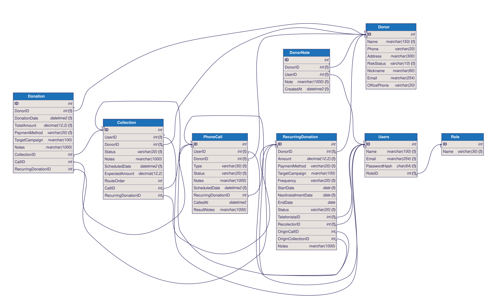
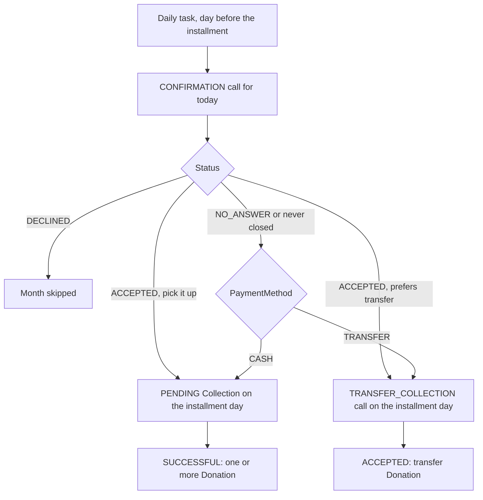
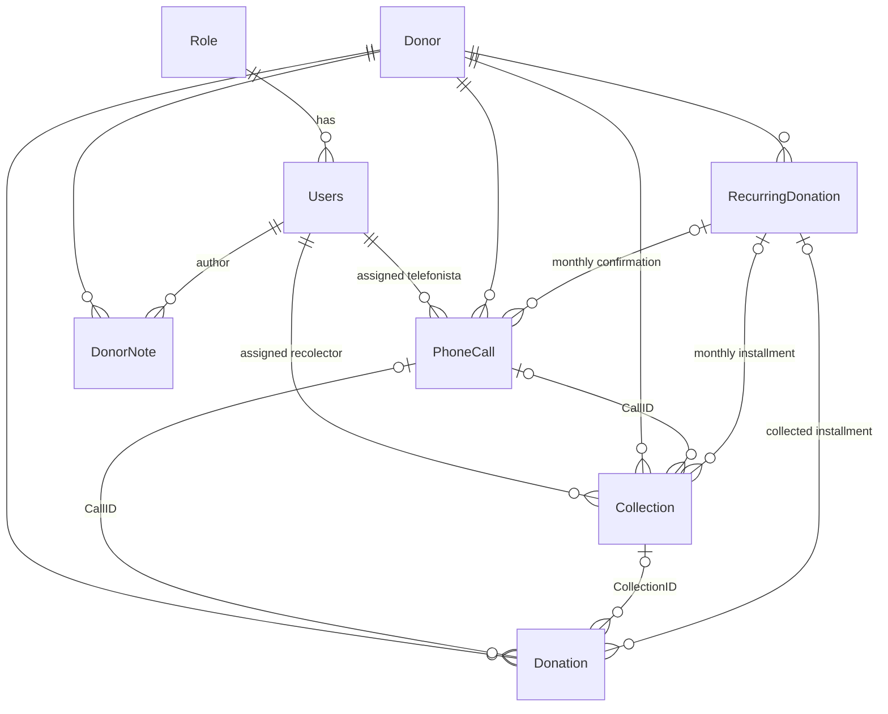

# Database

Data model shared by the API and the three apps (admin, telefonista and recolector). Engine: SQL Server.



- **Editable diagram:** [`database.dbml`](database.dbml). Paste it into [dbdiagram.io](https://dbdiagram.io) to view and rearrange it; the image above is generated from that file with `npx @softwaretechnik/dbml-renderer -i docs/database.dbml -o docs/img/database-diagram.svg`.
- **Creating the database:** [`API/sql/01_create_database.sql`](../API/sql/01_create_database.sql) drops the tables (including the original Spanish ones, shown in [`img/original-diagram.png`](img/original-diagram.png)) and creates everything below with its keys, `CHECK` constraints and indexes. [`API/sql/02_seed_data.sql`](../API/sql/02_seed_data.sql) loads test data: three users (`admin@`, `telefonista@` and `recolector@caritas.org.mx`, password `Caritas2026`), donors, today's calls and route, and two recurring pledges. The scripts have no `GO` and share no variables between statements, so they run in DBeaver with **Execute SQL Script** (Alt+X; Ctrl+Enter only runs the statement under the cursor) and with `sqlcmd -f 65001 -i <file>`.
- **Database accounts:** the API never connects as `sa`. [`API/sql/04_app_users.sql`](../API/sql/04_app_users.sql) creates the least-privilege logins `caritas_api` (the API) and `caritas_tasks` (the daily task); see [`API/sql/README.md`](../API/sql/README.md#app-accounts-04_app_userssql). Run it again after `01_create_database.sql`, since dropping the tables drops their grants.
- **Language:** everything in the database is in English, except the role names `Telefonista` and `Recolector` and what derives from them (`TelefonistaID`, `RecolectorID`, `/api/telefonistas/...`, `/api/recolectores/...`), which stay in Spanish. Texts shown to app users (for example the `Notes` the daily task writes on calls and collections) are in Spanish.

## People

There are two essential kinds:

- **Users** (`Users` table): the employees who log in to the apps. Each has a role (`Role` table): `Telefonista`, `Recolector` or `Admin`.
- **Donors** (`Donor` table): the clients. They do not log in; calls, collections and donations refer to them.

## Tables

### Role

| Column | Key | Description |
|---|---|---|
| ID | PK | |
| Name | | `Admin`, `Telefonista` or `Recolector` (the API compares them case-insensitively, see `API/auth.py`). The apps show them in Spanish with `AuthConfiguration.roleDisplayName`. |

### Users

| Column | Key | Description |
|---|---|---|
| ID | PK | |
| Name | | |
| Email | | Used to log in. |
| PasswordHash | | `pbkdf2:sha256:600000$<salt>$<hash>` of the app's hex SHA-256 plus the API pepper (`API/passwords.py`). Seed scripts insert the plain SHA-256; `python3 -m tasks.hash_passwords` converts it. |
| RoleID | FK → Role.ID | A user has a single role. |

### Donor

| Column | Key | Description |
|---|---|---|
| ID | PK | |
| Name | | |
| Phone | | |
| Address | | Where the recolector goes. |
| RiskStatus | | `LOW`, `MEDIUM` or `HIGH`. |
| Nickname | | Optional. How the donor likes to be called; shown to the telefonista. |
| Email | | Optional. |
| OfficePhone | | Optional. Second phone, shown to the telefonista. |

### DonorNote: telefonista log

| Column | Key | Description |
|---|---|---|
| ID | PK | |
| DonorID | FK → Donor.ID | |
| UserID | FK → Users.ID | Telefonista who wrote the note. |
| Note | | Free text. |
| CreatedAt | | Defaults to `SYSDATETIME()`. The donor screen lists the notes newest first. |

### Donation: history, past only

| Column | Key | Description |
|---|---|---|
| ID | PK | |
| DonorID | FK → Donor.ID | **Required.** If the donor does not exist, it is created before recording the donation. |
| DonationDate | | When it was received. Never in the future. |
| TotalAmount | | |
| PaymentMethod | | `CASH` or `TRANSFER`. |
| TargetCampaign | | |
| Notes | | |
| CollectionID | FK → Collection.ID | Optional. The collection where it was received. A collection can have **several** donations (e.g. Paco and his wife both donate on the same visit). |
| CallID | FK → PhoneCall.ID | Optional. The call that achieved a transfer donation, to measure each telefonista's contribution. |
| RecurringDonationID | FK → RecurringDonation.ID | Optional. Set when the donation is an installment of a recurring pledge. |

### Collection: scheduled visits

| Column | Key | Description |
|---|---|---|
| ID | PK | |
| UserID | FK → Users.ID | Assigned recolector. |
| DonorID | FK → Donor.ID | Donor to visit. |
| Status | | `PENDING` (scheduled, not done yet), `SUCCESSFUL` (done and collected), `FAILED` (done but nobody answered the door or they did not want to donate). |
| Notes | | If `FAILED`, the reason. |
| ScheduledDate | | Day (and time) of the visit. |
| ExpectedAmount | | |
| RouteOrder | | Order within the day's route; visits without one go last. |
| CallID | FK → PhoneCall.ID | Optional. The call that originated the collection. |
| RecurringDonationID | FK → RecurringDonation.ID | Optional. Set when the visit is an installment of a recurring pledge. |

### PhoneCall: scheduled calls

| Column | Key | Description |
|---|---|---|
| ID | PK | |
| UserID | FK → Users.ID | Assigned telefonista. |
| DonorID | FK → Donor.ID | Donor to call. |
| Type | | `REGULAR` (scheduled by an admin), `CONFIRMATION` (the day before a recurring installment) or `TRANSFER_COLLECTION` (on the installment day, to complete the transfer). Default `REGULAR`. |
| Status | | See values below. |
| Notes | | Goal of the call and what was discussed. Shown to the telefonista. |
| ScheduledDate | | Day (and time) the call must be made. |
| RecurringDonationID | FK → RecurringDonation.ID | Optional. The pledge a `CONFIRMATION` or `TRANSFER_COLLECTION` call belongs to. |
| CalledAt | | When the telefonista saved the result. `NULL` while `PENDING`. |
| ResultNotes | | What the telefonista wrote when saving the result. `Notes` keeps the goal set by whoever scheduled the call. |

The original `Contestada` (answered) column was dropped: it can be derived from `Status` (anything other than `PENDING` or `NO_ANSWER` was answered).

`Status` values:

| Value | Meaning | What happens next |
|---|---|---|
| `PENDING` | Not made yet. | Shows up in the telefonista's app that day. |
| `NO_ANSWER` | No answer. | For a regular call, the operator or an admin decides whether to schedule another. For a confirmation call, the default applies (see below). |
| `DECLINED` | Answered but did not want to donate or schedule anything. | Nothing. For a confirmation call, that month's installment is skipped. |
| `ACCEPTED` | Answered and agreed to donate. | Depending on what was agreed: a transfer `Donation`, a `Collection`, a `RecurringDonation` or several of them, all linked to this call. |
| `RESCHEDULED` | Answered and asked to be called another day. | Another `PENDING` `PhoneCall` is created on the requested date. |

No separate value is needed for "transfer" or "collection": that is known from the rows linked to the call.

### RecurringDonation: recurring pledges

A donor who commits to donating every month. It is not a donation (those are past only); it is the promise that generates each month's confirmation calls and collections.

| Column | Key | Description |
|---|---|---|
| ID | PK | |
| DonorID | FK → Donor.ID | |
| Amount | | Amount promised per installment. |
| PaymentMethod | | `CASH` (collected) or `TRANSFER`. |
| TargetCampaign | | |
| Frequency | | `MONTHLY` for now; the column leaves room for others. |
| StartDate | | First installment. Its day of the month is kept: if a month lacks it, the last day is used (Jan 31 → Feb 28 → Mar 31). |
| NextInstallmentDate | | Pending installment. Moves one month ahead each time the current one is resolved. |
| EndDate | | Optional. Once passed, the pledge becomes `FINISHED`. |
| Status | | `ACTIVE`, `PAUSED`, `CANCELLED` or `FINISHED`. |
| TelefonistaID | FK → Users.ID | Required. Makes the monthly calls. |
| RecolectorID | FK → Users.ID | Required. Collects every month, also when a transfer donor prefers someone to pick the money up. |
| OriginCallID | FK → PhoneCall.ID | Optional. The call where the pledge was obtained. |
| OriginCollectionID | FK → Collection.ID | Optional. The visit where it was obtained. |
| Notes | | |

#### How each month works



1. **Day before the installment.** The daily task creates a `CONFIRMATION` `PhoneCall` for today, assigned to `TelefonistaID`:
   - Cash: confirm the donor can receive the recolector tomorrow.
   - Transfer: ask whether tomorrow they prefer someone to pick it up or a call to complete the transfer.
2. **The telefonista closes it.**
   - `ACCEPTED`: what the donor chose (collection or transfer call) is scheduled for the installment day.
   - `DECLINED`: that month is skipped.
   - `NO_ANSWER`: the default for the payment method applies. **With cash, the recolector is sent anyway.**
   - In every case `NextInstallmentDate` moves one month ahead.
3. **Installment day.** If nobody resolved the installment (the call stayed `PENDING`, `NO_ANSWER` or `RESCHEDULED`), the daily task applies the default before the day starts.
4. **Recolector or telefonista collects.** A `SUCCESSFUL` collection generates one or more `Donation`; an `ACCEPTED` `TRANSFER_COLLECTION` call generates the transfer `Donation`. Both with `RecurringDonationID`.

This way the recolector's app only shows the day's visits, either confirmed or for cash donors.

#### Daily task

`API/tasks/daily_recurring_donations.py`, with the logic in `API/recurring_donations.py`. It runs separately from the Flask server, as one more process of the services server, once a day early in the morning:

```
0 6 * * * cd /path/to/repo/API && .venv/bin/python -m tasks.daily_recurring_donations >> /var/log/recurring_donations.log 2>&1
```

It uses the same `API/.env` as the API. It can run several times a day without duplicating anything: each installment is resolved only once (`NextInstallmentDate` changes in the same transaction) and the confirmation call is only created if it does not exist. If anything fails it exits with code 1.

The endpoint the telefonista will use to close a confirmation call must call `recurring_donations.resolve_installment(pledge_id, installment, action, call_id)` with the action the donor chose (`COLLECTION`, `TRANSFER` or `SKIP`). `call_id` becomes the collection's `CallID`. It locks the pledge row (`UPDLOCK`) and returns `False` without changing anything when the pledge is not `ACTIVE` or that installment was already resolved, so calling it twice is safe. An overdue installment is scheduled for today.

## Relationships



## Business rules

1. **`Donation` is history only.** Every time money comes in, by any means, a row is recorded. There are never future donations; what is still to be collected lives in `Collection` and future promises in `RecurringDonation`.
2. **Every donation has a donor.** If it does not exist, it is created first.
3. **`Collection` is what is scheduled.** It is assigned to a recolector. Once done it becomes `SUCCESSFUL` or `FAILED`; a successful one can generate one or more `Donation`.
4. **`PhoneCall` is what is scheduled for telefonistas.** An accepted call can end in a transfer donation, a collection, a recurring pledge or several of them.
5. **Recolector app:** shows the day's `PENDING` collections of the logged-in recolector (`Collection.UserID`).
6. **Telefonista app:** shows the day's `PENDING` calls of the logged-in telefonista (`PhoneCall.UserID` + `ScheduledDate`).
7. **Admin app:** has a section to create calls, collections and pledges and assign them to an employee.
8. `PhoneCall.UserID` must be a telefonista and `Collection.UserID` a recolector. The foreign key does not guarantee it; the API validates it.

## Current API usage

| Endpoint | Tables | File |
|---|---|---|
| `POST /api/login/attempt` | Users, Role | `API/routes/login.py`, `API/database.py` |
| `POST /api/login/verify` | Users, Role | `API/routes/login.py` |
| `POST /api/user` | Users, Role | `API/routes/user.py` |
| `GET /api/recolectores/route?date=` (Recolector token) | Collection, Donor | `API/routes/recolectores.py` |
| `GET /api/telefonistas/calls` (Telefonista token) | PhoneCall, Donor, RecurringDonation | `API/routes/telefonistas.py`, `API/telefonistas_db.py` |
| `GET /api/telefonistas/donors/<id>` (Telefonista token) | Donor, RecurringDonation, PhoneCall, Collection, DonorNote | `API/routes/telefonistas.py`, `API/telefonistas_db.py` |
| `POST /api/telefonistas/calls/<id>/result` (Telefonista token) | PhoneCall (`Status`, `ResultNotes`, `CalledAt`), Collection, Users | `API/routes/telefonistas.py`, `API/telefonistas_db.py` |
| `POST /api/telefonistas/donors/<id>/notes` (Telefonista token) | DonorNote | `API/routes/telefonistas.py`, `API/telefonistas_db.py` |
| `GET /api/adminPanel/dashboard` (Admin token) | Collection, Donor, Donation, RecurringDonation | `API/routes/admin_panel.py` |
| `GET /api/adminPanel/monthlyDonations` (Admin token) | Collection | `API/routes/admin_panel.py` |
| `GET /api/adminPanel/donors?months=N` (Admin token) | Donor, Donation, RecurringDonation, Collection, Users | `API/routes/admin_panel.py`, `API/controllers.py` |
| `GET /api/adminPanel/donors/<id>?months=N` (Admin token) | Donor, Donation, RecurringDonation, PhoneCall, Collection, Users | `API/routes/admin_panel.py`, `API/controllers.py` |
| `POST /api/adminPanel/donors` (Admin token) | Donor | `API/routes/admin_panel.py`, `API/controllers.py` |
| `GET /api/adminPanel/staff` (Admin token) | Users, Role | `API/routes/admin_panel.py`, `API/controllers.py` |
| `POST /api/adminPanel/calls` (Admin token) | PhoneCall (`REGULAR`, `PENDING`), Donor, Users | `API/routes/admin_panel.py`, `API/controllers.py` |
| `POST /api/adminPanel/collections` (Admin token) | Collection (`PENDING`, no `RouteOrder`), Donor, Users | `API/routes/admin_panel.py`, `API/controllers.py` |
| `GET /api/adminPanel/personal?months=N` (Admin token) | Users, Role, PhoneCall, Collection, Donation | `API/routes/admin_panel.py`, `API/controllers.py` |

## To do

### Database

- [ ] Run `API/sql/01_create_database.sql` (and `02_seed_data.sql` / `03_demo_data.sql` for test data, see `API/sql/README.md`) on the server, together with deploying the API and the apps.
- [ ] Schedule the daily task's cron job on the server.

### API

- [ ] **Endpoint for the telefonista to close a call**, which for confirmation calls calls `recurring_donations.resolve_installment`.
- [ ] **Admin endpoint to create pledges.** Calls and collections are already created with `POST /api/adminPanel/calls` and `POST /api/adminPanel/collections`, which check rule 8.
- [ ] **The dashboard counts money from `Collection`, not `Donation`.** `get_kpis` and `get_monthly_donations` (`API/database.py`) add up `Collection.ExpectedAmount` of the `SUCCESSFUL` ones. Per rule 1 it should add `Donation.TotalAmount`: that includes transfers and uses the real amount. "Pledged money" can come from `PENDING` collections plus `ACTIVE` pledges.
- [ ] **The monthly chart does not separate years.** It groups by `MONTH(...)`; September 2025 and September 2026 are added together.
- [x] **`/telefonistas/calls` returns every call.** It now requires a Telefonista token and returns only that user's calls for today.
- [x] **`/recolectores/route` takes `userId` as a parameter.** It now requires a Recolector token and takes the user from it. Still to do: only show `PENDING`.
- [ ] **`/telefonistas/calls` uses the latest donation as "pledge" and "last contact".** The pledge should be the active recurring pledge or the pending collection, and the last contact the latest answered call.
- [x] **`activeDonors` counts every donor.** Defined: a donor is active with an `ACTIVE` pledge or a donation in the last N months (`ACTIVE_DONOR_MONTHS = 6` in `API/controllers.py`; the donor screen lets the admin pick 3, 6 or 12).
